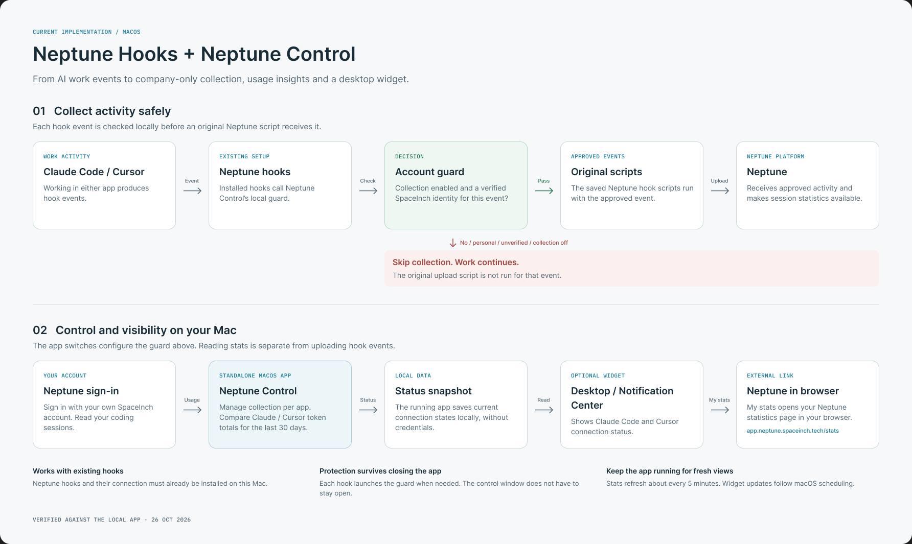

# Neptune Hooks + Neptune Control

A high-level pipeline for the current Neptune Control macOS app: company-only hook collection, per-app controls, usage insights and an optional desktop widget.

[Edit the pipeline in Figma](https://www.figma.com/design/E587bvgdGPwtnpo4bfd4lh/Untitled?node-id=3-2)

## Collect activity safely

1. **Claude Code or Cursor** produces a hook event during work.
2. **Installed Neptune hooks** call Neptune Control's local account guard.
3. **The guard checks this event** for a verified SpaceInch identity and enabled collection. Personal, missing, conflicting or unsupported identities are denied.
4. **Approved events** are passed to the saved original Neptune scripts, which perform the upload using the existing Neptune connection.
5. **Denied events** skip the original upload script. Work in Claude Code or Cursor continues.

Each event is checked independently. The guard runs when a hook is invoked, even when the control app is closed. Turning collection off persists across app restarts.

## View and control activity

- **Neptune Control** shows local account and connection states and lets the user enable or disable collection for each app.
- **Neptune sign-in** connects the user's own SpaceInch Neptune account. The app reads that account's coding sessions and compares Claude Code and Cursor token totals for the last 30 calendar days, including today. Totals include input, output, cache-read and cache-write tokens.
- **The optional macOS widget** reads a local, credential-free status snapshot written by the running app. It shows Claude Code and Cursor connection status on the desktop or in Notification Center.
- **My stats** opens [Neptune statistics](https://app.neptune.spaceinch.tech/stats) in the user's browser.

Stats are read separately from hook uploads. A green status dot indicates local collection readiness; it does not confirm successful remote delivery.

## Operating requirements

Neptune hooks and their connection must already be installed on the Mac. Keep Neptune Control running for fresh app statistics and widget snapshots. The app requests statistics roughly every five minutes; macOS controls when widget updates appear.

This pipeline describes the managed Claude Code and Cursor hooks on the local Mac. It was checked against the implementation on October 26, 2026.
