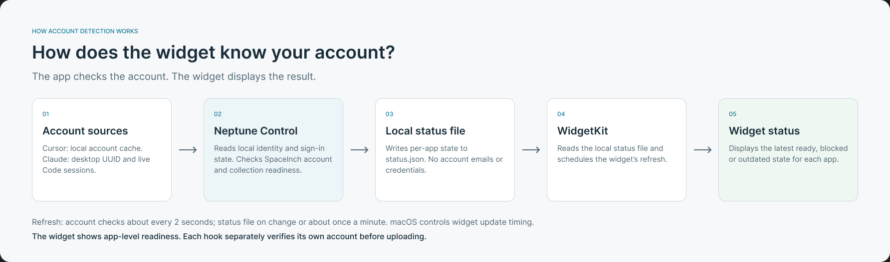

# How does the widget know your account?

**The app checks local account information. The widget displays the resulting status.**

1. **Account sources:** Cursor provides a locally saved email and sign-in presence. Claude provides its desktop account UUID and live Code session identities.
2. **Neptune Control:** reads these signals separately for each app, classifies SpaceInch, personal or unknown identities, and checks collection readiness.
3. **Local status file:** the app writes per-app status flags and timestamps to `status.json`, without account email addresses or credentials.
4. **WidgetKit:** reads that local file. It does not inspect Cursor or Claude directly.
5. **Widget:** displays the latest ready, blocked or outdated status supplied by the app.

## What is checked locally?

| App | Identity signals |
| --- | --- |
| Cursor | Saved email, presence of a sign-in entry and whether Cursor is running. No token value is returned. |
| Claude | Desktop account UUID mapped to a known email, sign-in cookie presence and expiry, and email/account UUID metadata from live Code workers. Unknown identities remain unverified. |

These are local identity signals. The app does not validate the Cursor session with Cursor's servers. Claude desktop and terminal accounts may differ; the widget shows app-level readiness rather than selecting one email among multiple sessions.

## How fresh is it?

The running app checks accounts about every **2 seconds**. It writes the status file on changes or about **once per minute**. WidgetKit controls when the display refreshes. A snapshot older than **5 minutes** changes the widget message to **Open app to update**.

Each hook event is authorized separately before upload. Personal or unknown hook identities are blocked; the displayed account cache never authorizes an event.

[Editable Figma flow](https://www.figma.com/design/E587bvgdGPwtnpo4bfd4lh/Untitled?node-id=11-2) · [Mermaid source](account-detection.mmd)
